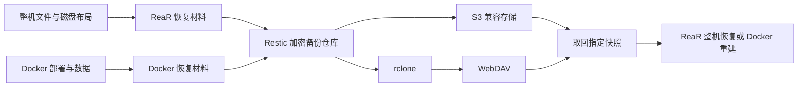

# 备份与恢复设计

状态：实现依据。设计日期：2026-10-30。实际接口与兼容边界见[使用说明](backup-management.md)，已经执行和未执行的验证见[验收记录](backup-validation.md)；下文的平台矩阵仍是覆盖目标。

目标是在原 VPS 和服务商均不可用时，仍能从 WebDAV 或 S3 取回备份，在本地 Linux 虚拟机或其他服务器恢复系统和业务。整机恢复采用 ReaR；Docker 另外提供独立恢复路径。功能、外部工具和定时运行环境按使用情况安装，不进入管理器的常驻 core。

## 1. 核心方案

采用 ReaR、Restic 和按需使用的 rclone，职责如下：

| 组件 | 职责 | 加载时机 |
| --- | --- | --- |
| ReaR | 生成救援启动介质、磁盘布局及系统备份，执行裸机恢复 | 配置或执行整机备份时 |
| Docker 备份实现 | 清点部署、镜像、容器可写层和持久化数据，生成可重建服务的恢复材料 | 使用 Docker 备份时 |
| Restic | 加密、去重、压缩、远端快照、校验和保留策略 | 实际配置或操作备份仓库时 |
| rclone | 为 Restic 提供 WebDAV 访问 | 使用 WebDAV 时；S3 路径不依赖它 |
| systemd timer 或 cron | 调用已经安装的备份运行文件 | 启用定时任务时 |



ReaR 的首版路径采用内置 NETFS/tar 生成本地恢复材料，再由 Restic 保存整套材料。恢复时先用 Restic 取回，再交给 ReaR。这里没有假设 ReaR 原生支持 Restic：上游列出的原生备份后端包括 NETFS、BORG、EXTERNAL 等，未列 Restic。[ReaR 后端与恢复流程](https://relax-and-recover.org/about/)

S3 使用 Restic 原生后端；WebDAV 使用官方支持的 `rclone:<remote>:<path>` 后端，rclone 的启停由 Restic 管理。无需挂载 WebDAV，也无需常驻 rclone 服务。[Restic 存储后端](https://restic.readthedocs.io/en/stable/030_preparing_a_new_repo.html#other-services-via-rclone)

整机和 Docker 快照独立完整，互不依赖另一类快照才能恢复。一次恢复选定一个确定的快照；不能自动把较新的 Docker 数据覆盖到旧整机备份上，否则可能造成数据库与应用版本不匹配。

## 2. 命令与按需分发

首版沿用现有 `system` 领域，新增三个公开入口，保持旧版安装器对新 Release manifest 的可读性：

| 命令 | 职责 | 功能包 |
| --- | --- | --- |
| `vpsctl system backup-repo` | 仓库连接、初始化、检测、查看、校验和清理 | `system-backup-repo` |
| `vpsctl system backup` | ReaR 整机计划、备份、恢复与调度 | `system-backup` |
| `vpsctl system backup-docker` | Docker 清点、计划、备份、恢复与调度 | `system-backup-docker` |

每个入口遵守 `commands/<domain>/<action>.sh` 约定，复杂实现放入同名私有目录。仓库访问、配置解析、任务记录、通用调度等确实被多个入口复用的部分放入 `shared-backup`；它不包含 ReaR 或 Docker 专属流程。各公开入口不互相调用。

分发沿用现有精确文件清单、同版本 manifest、SHA256、缓存锁和原子提交，不引入子命令级的另一套下载机制。项目虽预留了 `backup/` 目录，但当前 `vpsctl.sh` 与 `lib/distribution.sh` 均不接受 `backup-*` 包名前缀，旧版 self update 也会先用旧解析器读取新 manifest。只在新版本增加前缀不能解决旧版直接升级的问题。采用既有 `system-*` 和 `shared-*` 前缀，避免为此功能引入安装迁移或两阶段更新。

需要同步修改：

- `lib/registry.sh`：在 system 领域追加三个命令，保留既有菜单编号，登记各包文件与 `shared-backup` 依赖。
- `commands/system/backup.sh`、`backup-docker.sh`、`backup-repo.sh` 及各自私有模块；复用部分通过共享库提供，不互调公开入口。
- 发布资产与分发测试：沿用注册表驱动构建，补充三个功能包及共享包的覆盖。

下载边界必须区分项目脚本与外部软件：

| 用户操作 | 下载或安装行为 |
| --- | --- |
| 安装或更新 vpsctl、查看总菜单 | 只处理 core，不预取备份功能 |
| 首次进入某项功能或查看其帮助/status | 按现有机制下载该功能脚本及共享脚本；不安装 ReaR、Restic、rclone |
| 配置或使用 S3 仓库 | 按需准备 Restic；不安装 rclone |
| 配置或使用 WebDAV 仓库 | 按需准备 Restic 和 rclone |
| 使用 Docker 备份 | 不下载 `system-backup`，不安装 ReaR；按动作准备 Docker 客户端、归档辅助工具 |
| 使用整机备份 | 再检测并准备 ReaR、GNU tar、引导和 ISO 所需工具 |
| 定时任务执行 | 使用已准备好的本地运行文件；不临时访问 GitHub、不自动升级依赖 |

外部工具优先复用能力和版本满足要求的现有安装。缺少时沿用 `--install-deps` 授权；可使用系统包或经过版本、架构与摘要校验的官方二进制。ReaR 及其系统工具依赖按发行版适配，不把一个通用二进制当成所有系统的完整依赖。

全局 `--dry-run` 展示源、目标、遗漏、停服范围、空间需求及计划变更，不写配置、不停服务、不上传。安装态首次调用仍可能下载项目功能包，这是现有分发行为；功能执行本身保持只读。

## 3. 仓库、计划与恢复材料

一个仓库记录连接方式与密钥引用；一个计划记录备份类型、源范围、目标仓库、数据一致性方式、时间表、暂存目录和保留策略。支持同一仓库保存多个计划，首版每个计划只有一个远端目的地，不增加多目的地事务。

建议部署布局：

```text
/etc/vpsctl/backup/
  repos/<id>.json                 # 连接参数与凭据引用
  plans/<id>.json                 # 备份范围、调度、保留策略
  secrets/                       # 仓库密码与访问凭据
/var/lib/vpsctl/backup/
  jobs/<id>/                     # 任务状态、停服前状态、结果与错误
  staging/                       # 默认暂存目录，可改到其他磁盘
  cache/                         # 可重新生成的工具及镜像归档缓存
/usr/local/libexec/vpsctl/backup/
  ...                            # 已启用功能的独立运行文件
/run/vpsctl/                    # 运行锁
```

配置和清单采用带 `schema_version` 的结构化格式，不把数据文件作为 Shell 脚本加载。新版本能够读取其承诺支持的旧备份格式；格式不兼容时先说明需要的恢复工具版本，禁止猜测解析。

每个远端快照包含：主机标识、计划标识、任务标识、类型、实际采集时间、源系统/架构/工具版本、覆盖与排除清单、一致性方式、必要的恢复工具、数据材料及恢复说明。整机快照还包含同次生成的救援介质和布局信息。Docker 快照包含它引用的全部镜像归档，即使归档文件来自本地缓存，也必须纳入本次快照。

停服前的服务和容器运行状态作为不可变清单单独保存，不能依赖在停止状态下归档的 Docker 自启标记推断恢复后应启动哪些容器。本次任务持续变化的执行日志与临时状态不作为系统一致性数据；恢复时清除旧任务的活动标记，保留可追溯的历史结果。

不通过“引用另一个快照里的镜像/ISO”节省逻辑内容；去重交给 Restic，从而避免保留策略删除前序快照后导致后续备份无法恢复。

所有备份以加密仓库存储。凭据文件使用 0600，敏感目录使用 0700；日志和 `status --json` 脱敏。暂存的原始数据同样限制访问，空间不足或失败时不得自动删除其他备份或用户文件。

## 4. WebDAV 与 S3

| 后端 | 配置与兼容点 |
| --- | --- |
| S3 | endpoint、bucket、prefix、region、访问密钥及可选 session token；支持显式 path-style/virtual-hosted 配置，保留自定义 CA 能力 |
| WebDAV | URL、用户名/应用密码或可用的 bearer token、vendor、路径前缀；按服务能力设置并发、超时和 pack 大小 |

连接检测与写入检测分开：`repo check` 读取仓库状态；`repo probe` 在独立探测前缀创建、列举、读回校验并删除小文件。初始化和启用定时任务前完成实际写入能力检查。首次真实备份与读回还要验证所选 pack 大小是否适合服务端的单文件限制，不能用一个小文件测试宣称完全兼容。

普通 WebDAV 不保证提供可靠修改时间和内容哈希，因此不用远端时间、文件长度或 ETag 作为内容完整性的充分证据，校验交给 Restic 的仓库及数据读取能力。[rclone WebDAV 限制](https://rclone.org/webdav/#modification-times-and-hashes)

处理规则：

- 网络抖动、限流和临时服务错误有限重试并退避；认证失败、权限不足、额度不足先报告原因，不无限重试。
- 上传失败后保留已完成的本地采集结果，重试上传同一份材料，不再次停服务；Restic 可复用已存储的数据，不承诺任何服务端都支持单个上传对象按字节续传。
- 不使用 `rclone sync` 镜像仓库，不让本地清理变成远端删除。仓库内容维护只走 Restic。
- TLS 默认验证证书；私有 CA 通过显式配置接入，不把关闭验证作为自动兼容方式。
- S3 生命周期规则不得独立删除仍被快照引用的仓库对象。启用 Object Lock、只读或特殊写入权限时，分别报告备份、解锁、标记和清理能力，不假定 `forget/prune` 一定可用。
- 服务商凭据和仓库解密密码必须有服务器之外的副本；不能只把密码备份在需要该密码才能解开的仓库里。

## 5. 整机备份

### 5.1 覆盖范围

清点系统盘、EFI/boot 分区、数据盘、LVM、文件系统、挂载点、引导方式和网络设置，保存系统配置、软件、用户、业务文件及文件权限等恢复所需内容。所有本地持久文件系统都必须明确标为“纳入”或“排除”，不因只遍历根分区而漏掉 `/boot`、独立 `/var` 或业务盘。

Docker 数据目录按实际配置识别，包括非默认 `data-root`、containerd 数据及宿主机 Bind Mount 路径。Docker 29 新安装和升级安装的存储布局可能不同，不能写死一个目录。[Docker 数据目录](https://docs.docker.com/engine/daemon/)

排除 `/proc`、`/sys`、运行时伪文件系统、Swap 内容以及本功能的暂存、缓存、挂载目标和递归备份目录。保留备份配置与恢复所需运行文件。符号链接、ACL、xattr、文件能力、硬链接、稀疏文件与数字 UID/GID 必须按源与目标文件系统能力处理。

网络文件系统、外部块存储、未挂载数据盘等单列覆盖结果。它们不会因为存在一个挂载点就被认定已备份，也不会被静默忽略。归档写入的目标磁盘或挂载点必须从源范围排除。

### 5.2 执行顺序与停服边界

默认采用可移植的维护窗口模式：

1. 检查仓库、工具、剩余空间、挂载状态和恢复条件，生成采集计划。
2. 记录本次需要停止的服务及原运行状态。正常停止计划内应用、数据库和 Docker 容器；若归档 Docker 内部存储，还需在确认没有其他使用者后停止相应 daemon、socket 激活入口及专用 containerd。
3. 由 ReaR 生成救援介质、布局和系统数据归档。归档完整结束前保持相关写入停止。
4. 无论采集成功或失败，恢复本次停下且原来正在运行的服务，并记录启动结果。
5. 采集成功后用 Restic 上传固定不变的材料，核对快照与必需文件，再记录远端完成状态。

不能把“容器停了”解释为所有宿主机数据都静止。清点到的宿主机数据库、共享写入者和用户指定服务同样纳入停服计划；无法协调的源必须说明一致性限制。操作系统普通在线文件备份也不承诺全盘原子时间点。

停止超时、被强制杀死或无法确认数据库正常退出时，不能继续标记为应用一致的完整恢复点。需报告具体服务并按既定状态恢复业务，不自动用强制终止替代正常停止。

首版不自动实现通用 LVM/Btrfs/ZFS 快照编排。LVM/Btrfs 可以作为经过验证的源布局支持，但不代表已经具备缩短停服时间的快照功能。用户已有的一致性快照可作为单独适配场景，须验证所有相关卷的时点和恢复布局。

因此停服时间至少覆盖本地一致性数据采集，而不包含后续网络上传；不能承诺固定为几秒或几分钟。无法接受该窗口时，Docker 可选经过适配的在线备份计划，整机备份仍按另行安排的窗口执行。

### 5.3 空间与增量

首版生成一套完整的 ReaR 数据归档，优先使用不预压缩的 tar，由 Restic 负责压缩和分块去重，避免整包预压缩削弱去重收益。每次整机采集仍会读取并暂存全量数据，远端传输量取决于实际变化和分块结果，不能称为无需全量扫描的增量整机备份。

预检按纳入数据、归档、救援介质、缓存和临时开销估算空间，并处理稀疏文件与挂载变化。`--work-dir` 允许使用额外磁盘或已挂载的合适存储；空间不足则在停服前失败并报告需求。流式整机上传不属于首版路径，避免把停服时间绑定到不稳定网络以及增加中断恢复分支。

## 6. Docker 备份

### 6.1 自动发现与完整性

计划默认覆盖本机选定 Docker daemon 中的所有容器，包含已停止的容器，避免服务刚好停止时漏掉数据；支持按 Compose 项目、容器和标签缩小范围。孤立卷和无容器引用的镜像单独列出，可选择纳入。备份前后检查清单变化，避免并发部署造成配置、镜像和数据不对应。

每个被选容器至少保存：

| 内容 | 处理方式 |
| --- | --- |
| 镜像 | 按容器实际 image ID 保存，记录 tag、digest 和平台；不只记一个可能变化的 `latest` |
| Compose | 保存源文件、override、环境文件、项目目录及解析后的部署定义；相关秘密随仓库加密 |
| 直接 `docker run` 的容器 | 保存 inspect 证据，并规范化为可重建的配置；覆盖入口、命令、环境、端口、挂载、网络、重启策略和已支持的 HostConfig |
| 容器可写层 | 检测变更，必要时在一致性窗口内 commit 成临时镜像并 save，同时保留原镜像与映射；不能只保存原始镜像 |
| Named/Anonymous Volume | 保存内容和卷定义；共享卷只采集一次，并还原所有容器的关联 |
| Bind Mount | 保存实际源文件/目录及映射；路径可以位于任何已声明的数据盘 |
| 网络与外部文件 | 保存可重建的网络定义、配置、证书、secret/config 文件和必要的设备依赖描述 |

`docker inspect` 输出并非可以原样提交的创建请求。恢复实现必须有明确字段映射；遇到影响启动的未支持字段，列出缺失项，不把这个容器标成“可自动恢复”。Compose 源文件丢失也不能阻止清点，可使用运行配置恢复路径并说明差异。

每个容器的清单明确记录 `original_image_id` 与 `restore_image_id`。有可写层归档时，重建必须使用 commit 后保存的恢复镜像；Compose 通过生成的恢复 override 指向该镜像，直接 run 路径使用同一映射。启动参数以采集时记录的容器定义为准，不让 commit 镜像默认配置覆盖原参数，卷内容仍单独恢复。

卷数据通过受控辅助容器挂载归档，Bind Mount 按实际路径采集。辅助工具具备 GNU tar 所需元数据能力，镜像固定到已验证版本并纳入恢复材料；不直接拼接 overlay2 或 containerd 内部目录作为 Docker 独立迁移协议。

Docker socket、设备、`/proc` 等运行时挂载只记录为目标环境依赖，不作为普通业务目录归档。识别和排除的理由写入覆盖清单，不能把它们与未能读取的持久化数据混为一类。

`docker save` 不保存容器新增数据；`docker commit` 不包含挂载卷；`docker export` 也不包含挂载卷。因此镜像、可写层和卷必须分别处理。[镜像归档](https://docs.docker.com/reference/cli/docker/image/save/) · [容器 commit](https://docs.docker.com/reference/cli/docker/container/commit/) · [容器 export](https://docs.docker.com/reference/cli/docker/container/export/)

### 6.2 数据一致性

提供两种显式模式，不因缺少数据库适配而自动从一种降级为另一种：

- `stop`：默认模式。按应用依赖关系正常停止相关写入者，归档卷、Bind Mount 和可写层后恢复原运行状态，再上传。停服范围包含共享数据的未选容器、可识别的其他 daemon 容器、宿主机进程以及计划声明的写入者，不能只停止被选容器。不能协调的共享写入或外部写入会阻止该数据进入应用一致的完整恢复点；前后容器清单相同不构成数据静止的证明。
- `online`：使用已验证的数据库原生备份及应用前后处理接口。首批适配 PostgreSQL、MySQL/MariaDB 和 SQLite，分别保存必要的角色/权限、对象和版本信息；未适配服务可提供显式的本地备份脚本或改用 `stop`。

在线模式不把活动数据库文件夹直接打包成一致备份。MySQL 的事务备份选项不能覆盖所有存储引擎和并发 DDL；SQLite 需要备份 API 或正确协调 WAL；PostgreSQL 多库与外部文件也需定义一致性范围。数据库加上传文件的业务要协调两者时点。[PostgreSQL 文件系统备份约束](https://www.postgresql.org/docs/17/backup-file.html)

Redis 等内存型服务不能仅凭容器已停止就认定数据已落盘：要完成原生持久化或专用导出，否则清单明确标为不完整。纯内存状态、tmpfs、进程与网络连接不在磁盘恢复承诺内。

独立 Docker 恢复优先使用归档镜像，不依赖原镜像仓库继续可用。所有本次引用的归档都放入本次快照，旧快照被清理不影响新快照。原始数据库文件恢复要求兼容版本；跨数据库大版本迁移使用相应逻辑导出，不自动升级数据库。

## 7. 恢复流程

### 7.1 原服务器完全丢失时

备份功能必须支持导出恢复工具包，包含启动介质、独立恢复入口、匹配版本的工具/共享依赖、仓库连接说明和必要元数据。仓库密码和访问凭据另外保存，不嵌入救援 ISO。恢复包可能含主机敏感信息，作为私有材料保管。

引导路径不得形成循环：

1. 有本地恢复工具包时，直接使用其中的救援介质与工具连接仓库。
2. 工具包不在手边时，在另一台 Linux 或临时 Linux 虚拟机中准备 Restic，以及 WebDAV 所需的 rclone，先取回快照内的救援 ISO 和恢复材料，再启动目标恢复环境。

恢复不依赖旧 VPS、本机任务数据库或 GitHub 当时可用。工具包解决恢复工具的离线启动；业务数据仍须从远端获取，除非另外导出了完整离线数据副本。Docker 路线的新宿主机还需要可用的 Docker Engine，不能承诺一个工具包可离线安装所有发行版的 Docker。

恢复包和脚本都有版本与格式记录；上游工具的来源、版本及校验信息随包保留。引导介质取回和工具自举与仓库密码的异地保存列为首次配置的交付内容。

### 7.2 整机恢复

先下载并核对选定快照的恢复材料，再在 ReaR 救援环境里执行恢复。操作计划明确展示备份来源、目标磁盘映射、将被覆盖的分区和网络配置。

Restic 与 ReaR 的交接使用显式路径契约：同一快照保存 NETFS 的目录层级、`NETFS_PREFIX`、`BACKUP_PROG_ARCHIVE`、压缩方式及匹配 ISO。恢复入口把这套材料放到救援环境可访问的存储上，再按所用 ReaR 版本生成恢复用的 `BACKUP_URL` 和对应前缀/归档名，不沿用旧 VPS 上已经不存在的本地路径。[ReaR NETFS 配置](https://github.com/rear/rear/blob/master/usr/share/rear/conf/default.conf)

具体传递方式为：直接在救援环境下载到保留盘；或在另一台机器取回后，用附加虚拟磁盘/移动存储交给目标，或通过已配置的 NFS 导出供救援环境挂载。挂载到例如 `/mnt/vpsctl-recovery` 后，先验证完整目录、归档可读性和摘要，再进入 ReaR 重分区阶段。需要的文件系统或 NFS 客户端驱动提前纳入恢复介质；无法提供可读存储时在擦盘前停止。

恢复暂存区必须位于不会被恢复流程重分区的磁盘/挂载点；禁止把唯一的数据归档放在即将擦除的目标盘上。内存盘只有容量足够时才能使用。不能因为新机器只有一块盘就自动选它兼作暂存盘和擦写目标。

ReaR 负责重建布局、恢复文件和引导；本项目负责取回材料、核验、目标映射、前置检查和结果记录。恢复后检查 fstab、磁盘 UUID、initramfs、引导模式、网卡、IP/DNS 和 cloud-init 的目标策略。生产接替与测试克隆必须区分：前者按迁移计划处理身份与网络，后者使用隔离网络并处理重复主机身份和自动任务。

恢复期间暂停本功能的受管备份调度；生产接替在网络和备份身份处理完成后按记录恢复调度，测试克隆保持关闭。依据停服前清单恢复容器与服务运行状态，不能让 `unless-stopped` 等策略把采集时人为停止的容器一直留在停止状态。

恢复完成后应重启、检查 SSH、系统服务和关键业务。整机磁盘覆盖不可承诺自动回滚；一旦开始擦写，失败时保留救援环境、材料与日志，提供继续恢复路径。

### 7.3 Docker 恢复

下载并验证材料后：检查 Engine/平台能力 → 导入镜像 → 建立网络与卷 → 恢复数据和权限 → 重建容器 → 按依赖顺序启动 → 执行服务检查。

空白主机恢复原名称、路径和运行状态；已有同名容器、卷、文件或端口冲突时，在执行前给出冲突和覆盖范围，支持显式映射或覆盖参数，不自动换端口或覆盖已有业务。源中原本停止的容器仍保持停止。

恢复可选择整套计划、单个 Compose 项目、容器或数据卷；选择单项时校验共享卷和依赖关系。部分启动失败单独报告，不能把“镜像已导入”当作业务恢复成功。

破坏性整盘覆盖或覆盖现有业务只进行一次完整范围确认，并提供绑定目标与快照的 `--confirm-*` 参数支持无人值守。普通下载、清点、计划和恢复到新目录不增加额外确认；全局 `--yes` 不替代目标明确的破坏性确认。

## 8. 兼容性与支持等级

“已验收”“满足前置条件但未验收”“明确不支持”必须分别展示，不能把检测到命令或发行版名称当成恢复能力证明。以下是实现和验证目标，并非已实现的支持承诺。

| 环境或场景 | 整机路径 | Docker/仓库路径 |
| --- | --- | --- |
| Debian/Ubuntu、x86_64、普通 KVM/VMware 虚拟机 | 优先验收，按具体发行版/版本记录结果 | 优先验收 |
| Rocky/Alma/RHEL 系、x86_64 | 按具体系统包、SELinux、引导与 ReaR 组合验收 | 按 Engine、归档权限和宿主机能力验收 |
| Alpine/OpenRC/musl | 首版不承诺 ReaR 整机恢复；显示具体能力缺口 | 目标支持 Docker 与远端仓库；补 GNU 工具并使用可用 cron |
| aarch64 | ReaR、固件和引导介质单独验收后开放，不继承 x86_64 结论 | 目标支持同架构镜像与数据恢复 |
| LXC/OpenVZ/容器内运行 | 缺少自主管理磁盘/内核时不提供宿主机裸机恢复 | 能访问正确本地 daemon 与数据时按能力开放 |
| ext4/XFS、独立 boot、EFI、普通 LVM | 首批整机覆盖；UEFI/BIOS 分别做启动恢复验收 | 验证所需文件元数据 |
| Btrfs 子卷、mdraid、LUKS、Secure Boot | 逐项核验 ReaR 支持、密钥和启动条件；未验收标为待适配 | 普通文件内容备份不等于相应整机布局已支持 |
| ZFS、特殊阵列、复杂多盘布局 | 首版不声称通用自动恢复 | 可备份可见业务文件，但明确覆盖范围 |
| Docker rootful、Compose v2、直接 docker run | 纳入整机覆盖及停服清点 | 首批支持目标 |
| Docker rootless/userns-remap | 清点实际用户和存储，不能仅查询 root 的 daemon | 单独适配与验收 UID/GID 映射；不能承诺 rootful 与 rootless 原样互迁 |
| 非默认 data-root、containerd image store | 自动发现实际路径 | 使用 Docker API/CLI 和卷接口，不依赖内部存储目录格式 |
| NFS/CIFS/卷插件、Swarm、远端 Docker context | 明确外部依赖与未覆盖范围 | 不默认当作本地普通卷/容器处理；需要专项适配 |
| GPU、设备映射、macvlan、固定外部 IP | 恢复前检查目标条件 | 缺少目标设备/网络时不能声明可自动启动 |
| x86_64 与 ARM 互迁 | 不作为普通整机恢复支持 | 需目标架构镜像及数据格式兼容方案；保存的单架构镜像不能直接通用 |
| 目标无 ISO/救援启动入口 | 不能承诺 ReaR 裸机恢复；先解决可用启动路径 | 可在已经安装的 Linux/Docker 上恢复 |
| 更小目标盘、不同 BIOS/UEFI | 不能仅按已用空间判断；需要明确布局转换与验收 | 按实际数据量、路径与目标能力判断 |

ReaR 上游明确区分发行版和架构支持，ARM 等架构不能简单按“Linux 可运行”推导支持。[ReaR 2.9 支持范围](https://relax-and-recover.org/documentation/release-notes-2-9#system-and-software-requirements)

Rootless 的容器 UID 与宿主机 UID 映射不同，源端采集和目标端恢复都须使用对应 daemon 和用户命名空间；拒绝通过盲目递归 chown 掩盖映射错误。[Docker UID/GID 映射](https://docs.docker.com/engine/security/rootless/uid-gid-mapping/)

本地 Windows/macOS 作为虚拟机宿主机不影响目标，但系统恢复在 Linux 虚拟机内完成；不能把文件先解压到 NTFS/exFAT 再复制回去，并声称 Linux 元数据完整。压缩归档和加密仓库可作为普通文件保存在这些文件系统上。

## 9. 调度、失败与保留策略

配置时准备好必需工具和自包含运行文件。systemd 使用 timer；非 systemd 使用经过检测的 cron 实现，仅修改本项目受管条目。不存在 cron 时按依赖流程准备，不假设 OpenRC 自带调度器。首版按主机时区调度，保存并显示所用时区及下次执行时间，不依赖不同 cron 实现对 `CRON_TZ` 的支持；主机时区变化后明确提示计划时间发生变化。

运行文件放在独立的 libexec 目录，每个已启用功能拥有自己的不可变版本目录，携带匹配版本的共享依赖。任务启动时只解析一次该功能的 current 指针，后续固定从解析出的目录加载全部文件。升级先完整写入并校验新目录，再原子切换指针；旧目录在仍有任务使用时保留，失败则继续使用原版本，不逐文件覆盖运行中的依赖。

这些运行目录不依赖会被 `self update` 清理的 release，也不因 core 切换而在定时运行时下载新版本。版本保留只服务于运行中任务与升级事务，不改变管理器既有的历史 release 清理规则。

任务状态区分采集、服务恢复、上传和远端完成；至少展示：

- 最近一次尝试及结果。
- 最近一次完整的远端备份及其真实采集时间。
- 最近一次仓库/数据校验及覆盖范围。
- 最近一次真实恢复演练结果。
- 当前原业务是否已恢复运行，以及待恢复的服务。

同主机系统和 Docker 的采集阶段互斥，避免互相停服务；仓库维护遵循 Restic 的锁。锁冲突与错过计划都要记录，不能静默更新“最近成功”。配置、错误和部分成功转换为项目既有退出码；Restic 的 `3` 表示不完整快照，应转换为项目的部分完成语义，而非成功或项目的前置条件错误。[Restic 退出状态](https://restic.readthedocs.io/en/stable/040_backup.html#exit-status-codes)

远端快照先标为候选，只有采集、上传和必要材料检查全部完成才进入本项目的完整恢复点列表。Restic 即使在源文件读取失败时也可能创建快照，必须检查退出状态；失败候选不替代最近完整备份。标记操作可能改变快照 ID，因此以任务标识对账并记录最终 ID，网络响应不明时先查仓库而非重复采集。

若数据上传成功但原服务启动失败，分别保存“远端数据完整”和“业务恢复失败”，任务整体返回部分完成，不能报一切正常。可捕获错误与信号尽力恢复本次停止的服务；掉电或 SIGKILL 不依赖 trap，保留持久恢复记录，在开机恢复入口或后续运行时核对处理，不承诺任意故障下零中断。

保留策略按仓库、源主机、计划与类型限定，再调用 Restic forget/prune。任务 ID、临时路径和瞬时标签不得成为独立的保留分组，避免每次备份都形成新组而永不清理。最新完整恢复点与正在恢复的数据受保护。新备份失败不触发删除旧完整备份。[Restic 保留策略与分组](https://restic.readthedocs.io/en/stable/060_forget.html)

实现补充：成功上传后自动按计划维护远端历史，维护结果独立记录。下次执行前，持采集锁核验同计划的旧成功快照仍完整存在，再清理其本地封存暂存文件并保留小清单；失败和候选材料不自动清理。空间估计按实际纳入/排除范围统计，避免把即将清理或明确排除的归档重新算入源数据。

常规任务检查结果与必要材料；按计划执行仓库结构检查、分批数据读回，以及单独的完整读回或恢复演练。默认 `restic check` 不读取全部数据，界面不得把它显示为全量内容验证。[Restic 校验范围](https://restic.readthedocs.io/en/stable/045_working_with_repos.html)

建议初始时间表为整机每周、Docker 每天，重要数据库另设更高频计划；这些只是配置默认候选，不在安装功能时自动启用。故障与超期未成功通过状态、日志及可选通知接口暴露。服务器完全消失时无法靠自身报警，需要由服务器之外检查备份新鲜度；本功能提供可查询结果，不附带一个新的监控平台。

卸载功能先停用其调度，清理对应受管运行文件与下载缓存，保留计划、凭据、本地恢复材料和全部远端备份；删除这些数据使用独立、范围明确的操作。不卸载其他功能共用的系统软件或工具。

## 10. 接口草案

以下均为拟议接口，不是当前可运行命令。无参数时交互终端进入菜单，非交互输出帮助或只读状态；`status` 不连接远端，远端查询使用明确动作。

```text
vpsctl system backup-repo configure <repo> --type s3|webdav
vpsctl system backup-repo probe <repo>
vpsctl system backup-repo init <repo>
vpsctl system backup-repo list
vpsctl system backup-repo check <repo> [--read-data | --read-data-subset ...]
vpsctl system backup-repo prune <repo> --plan <plan>

vpsctl system backup status [--json]
vpsctl system backup inspect
vpsctl system backup configure <plan> --repo <repo> --work-dir <path>
vpsctl system backup run <plan>
vpsctl system backup snapshots <plan>
vpsctl system backup restore-plan --repo <repo> --snapshot <id> ...
vpsctl system backup restore --repo <repo> --snapshot <id> ...
vpsctl system backup export-recovery <plan> --output <path>
vpsctl system backup schedule <plan> enable|disable|status

vpsctl system backup-docker status [--json]
vpsctl system backup-docker inspect
vpsctl system backup-docker configure <plan> --repo <repo> --consistency stop|online
vpsctl system backup-docker run <plan>
vpsctl system backup-docker snapshots <plan>
vpsctl system backup-docker restore-plan --repo <repo> --snapshot <id> ...
vpsctl system backup-docker restore --repo <repo> --snapshot <id> ...
vpsctl system backup-docker schedule <plan> enable|disable|status
```

恢复接口使用仓库与快照定位，不强制依赖已经丢失的本地 plan 配置。连接配置可通过恢复工具包重建，凭据通过受保护文件提供。配置向导提供编号选项；完整 CLI 支持无人值守，缺必填内容直接报错，不等待终端。

## 11. 实现顺序与验收

先完成仓库和共享运行流程，再完成 Docker 的默认一致性备份与真实重建，随后接入 ReaR 整机打包及裸机恢复，最后扩展在线数据库与额外平台适配。这个顺序用于尽早验证两条路径共用的存储和失败处理，不改变整机恢复必须交付的目标。

所有项目语法、静态检查、测试和实际验收均通过 `ssh host-vps-scripts` 执行；当前系统仅编辑与只读检查。远端可使用一次性容器和虚拟机，但容器测试不能替代整机启动验证。

首版完成条件：

1. 安装 core 和浏览菜单不下载备份包；只使用 Docker/S3 不下载 ReaR 或 rclone；功能更新、卸载和定时执行符合上述边界。
2. WebDAV 与 S3 分别完成真实写入、上传、读取恢复、校验和保留策略验证；兼容性结论限定到实际验证的服务实现。
3. Docker 用 Compose 与直接 run 部署至少覆盖数据库、上传文件、Named/Anonymous Volume、Bind Mount、共享卷、宿主机共享写入、容器可写层和停止状态；在没有源容器、镜像和数据的环境恢复并检查业务内容，确认恢复容器实际使用含可写层的镜像。
4. ReaR 在专用环境中的空白虚拟机，从异地快照恢复并成功启动；确认 SSH、系统配置、Docker 及业务数据。不同引导方式和文件系统按支持矩阵分别记录，未测组合不标已支持。
5. 验证网络中断、源文件读取失败、空间不足、服务停止/启动失败、任务被中断、远端候选快照、版本更新后的定时任务，以及覆盖目标冲突。检查原业务状态和历史完整备份保留情况；验证运行中升级不混用依赖，core 更新后首次调度无须下载代码。
6. 模拟原 VPS 和本机任务状态丢失，只凭外部保存的凭据/恢复材料重建；验证另机取回的材料在目标救援环境实际挂载后能够恢复，且恢复暂存盘不会被目标重分区擦除。

验收记录保存必要恢复信息、实际命令和覆盖范围，提交前脱敏。若远端不具备目标架构或虚拟化能力，相应项目标记阻塞或未运行，不以 mock、容器或一次上传成功代替真实恢复验收。
